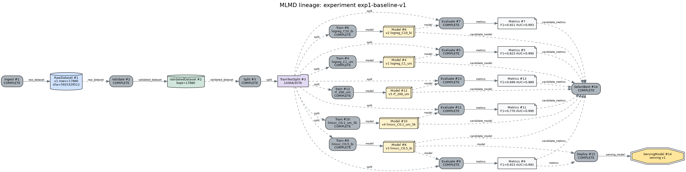
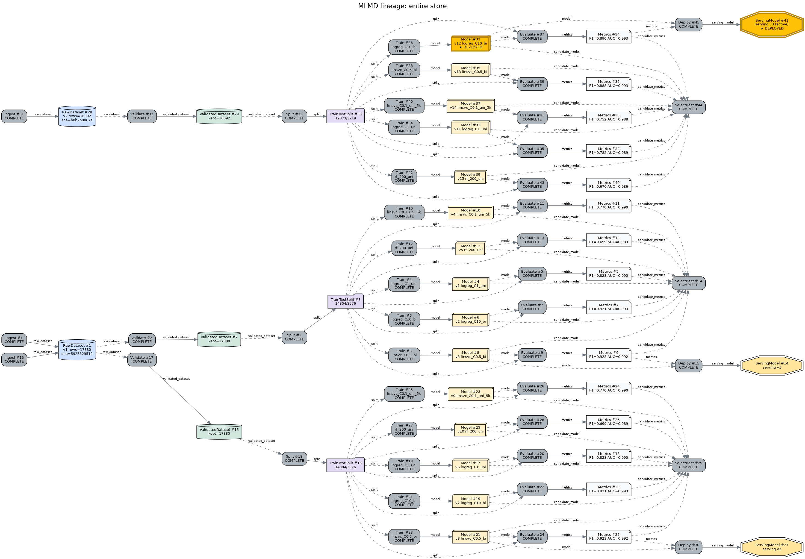

# Lab 6: ML Metadata (MLMD) lineage for fake job posting detection

IE7374 MLOps, Lab 6 (based on `MLMD_Labs/Lab2` of [raminmohammadi/MLOps](https://github.com/raminmohammadi/MLOps/tree/main/Labs/MLMD_Labs/Lab2)).

This project builds a multi-step ML pipeline (**ingest → validate → split → train ×N → evaluate ×N → select best → deploy**) for detecting fraudulent job postings in the EMSCAD dataset. Every step is recorded in an **ML Metadata (MLMD)** store using custom artifact, execution and context types. A command-line tool then queries that store to compare experiments, trace a model back to its raw data, trace a dataset forward to every model trained on it, and draw lineage graphs.



---

## Contents

1. [Prerequisites](#1-prerequisites)
2. [Get the code and the dataset](#2-get-the-code-and-the-dataset)
3. [Build and run](#3-build-and-run)
4. [Every CLI command](#4-every-cli-command)
5. [Re-run with a modified dataset (data v2)](#5-re-run-with-a-modified-dataset-data-v2)
6. [See a validation failure being recorded](#6-see-a-validation-failure-being-recorded)
7. [What a successful run looks like](#7-what-a-successful-run-looks-like)
8. [MLMD concepts used](#8-mlmd-concepts-used)
9. [Changes from the original lab](#9-changes-from-the-original-lab)
10. [Project layout](#10-project-layout)
11. [Troubleshooting](#11-troubleshooting)

---

## 1. Prerequisites

You need only two programs. Python, ml-metadata, scikit-learn and graphviz are all installed inside the Docker image.

| Tool | Version used | Install |
|---|---|---|
| **Git** | 2.40+ | https://git-scm.com/download/win |
| **Docker Desktop for Windows** with the **WSL 2** backend | Docker Engine 29.x, Compose v2 | https://docs.docker.com/desktop/setup/install/windows-install/ |

**Why Docker?** [`ml-metadata`](https://pypi.org/project/ml-metadata/) is a C++ library with Python bindings. It publishes **no Windows wheels**, and its Linux wheels support only certain CPython versions. Version 1.17.1, used here, ships `manylinux2014` wheels for CPython 3.9–3.11 only. Newer releases (1.18+) need glibc ≥ 2.39, which the standard `python:3.10-slim` (Debian bookworm) image does not have. So the project runs in **`python:3.10-slim-bookworm`** with every Python package pinned in [`requirements.txt`](requirements.txt). The build fails immediately if `import ml_metadata` does not work.

Setting up Docker Desktop on Windows:

1. Enable WSL 2: open **PowerShell as Administrator** and run `wsl --install`, then reboot.
2. Install Docker Desktop and keep **"Use WSL 2 based engine"** ticked (Settings → General).
3. Start Docker Desktop and wait until the whale icon says **"Engine running"**.
4. Check it in a normal PowerShell window:
   ```powershell
   git --version
   docker --version
   docker compose version
   docker run --rm hello-world
   ```

All commands below are for **PowerShell**, run from the project folder. They also work unchanged in macOS/Linux terminals.

## 2. Get the code and the dataset

```powershell
git clone https://github.com/rtm2191/Lab6_002034640.git
cd Lab6_002034640
```

**Dataset.** This is the *EMSCAD Employment Scam Aegean Dataset*: 17,880 job postings, of which 866 (4.8%) are fraudulent. The label column is `fraudulent`.

**It is already in the repo**: cloning gives you `data/fake_job_postings.csv` (v1) and `data/fake_job_postings_v2.csv` (v2, made by `scripts/make_data_v2.py`), so you can skip to [step 3](#3-build-and-run). The repo also contains the metadata store from the verified run (`mlmd_store/metadata.db`) and its trained models (`outputs/models/`, `outputs/serving/`). The query commands in [section 4](#4-every-cli-command) therefore work straight after `docker compose build`, without running the pipeline first.

If you ever need to download the original file again:

1. Download it from Kaggle: <https://www.kaggle.com/datasets/shivamb/real-or-fake-fake-jobposting-prediction>. A free Kaggle account is needed. Click **Download** to get `archive.zip`.
2. Unzip it and copy **`fake_job_postings.csv`** into this project's `data` folder:
   ```powershell
   Expand-Archive $HOME\Downloads\archive.zip -DestinationPath $HOME\Downloads\archive
   Copy-Item $HOME\Downloads\archive\fake_job_postings.csv .\data\
   ```
3. Check it: `Get-FileHash .\data\fake_job_postings.csv` should print SHA256 `59253295129D8B6A27607F9904F7D4DDF4DBB0EE35E079C7EB51B58B5E62BF60`. A different hash still works: the pipeline registers it as its own dataset version.

## 3. Build and run

```powershell
# Build the image (about 2 minutes the first time)
docker compose build

# Run the whole pipeline: 5 model configs from config/experiments.yaml (about 1 minute)
docker compose run --rm mlmd run --config config/experiments.yaml
```

`docker compose run --rm mlmd <command>` runs `python -m src.cli <command>` inside the container. These folders are mounted from your machine, so their contents persist between runs and you can open them directly:

| Host folder | Contents |
|---|---|
| `data/` | input CSVs |
| `config/` | experiment configs (edit without rebuilding) |
| `mlmd_store/metadata.db` | **the MLMD SQLite store** (open it with any SQLite browser if you like) |
| `outputs/` | models, serving model, comparison tables, traces, lineage graphs |

By default an experiment is named `<config name>-<UTC timestamp>`. Pass `--name` to choose your own, and `--data` to point at a different CSV.

## 4. Every CLI command

```powershell
docker compose run --rm mlmd --help

docker compose run --rm mlmd run --config config/experiments.yaml [--data data/x.csv] [--name my-exp]
docker compose run --rm mlmd list-experiments                       # Experiment contexts + status + best model
docker compose run --rm mlmd list-artifacts [--type Model]          # find ids for the trace commands
docker compose run --rm mlmd executions [--state FAILED] [--experiment NAME]
docker compose run --rm mlmd compare --experiment NAME              # runs, params, metrics; best marked ★
docker compose run --rm mlmd trace-model --model-id ID              # backward: model -> ... -> raw dataset
docker compose run --rm mlmd trace-data --artifact-id ID [--verbose]  # forward: dataset -> models -> deploy
docker compose run --rm mlmd graph --experiment NAME                # PNG + SVG + interactive HTML
docker compose run --rm mlmd graph --all                            # whole store (all data versions)
```

Anywhere a command takes `--experiment`, you can pass `latest` to mean the most recent experiment.

Outputs:

* `compare` → `outputs/compare_<experiment>.md` and `.csv`
* `trace-model` / `trace-data` → `outputs/trace_model_<id>.txt` / `outputs/trace_data_<id>.txt`
* `graph` → `outputs/graphs/lineage_<experiment>.png`, `.svg` and `.html`. Open the `.html` file in a browser: you can drag and zoom, and hovering a node shows all of its MLMD properties. It loads vis-network from cdnjs, so it needs an internet connection.

```powershell
start outputs\graphs\lineage_all.html     # open the interactive graph (Windows)
```

## 5. Re-run with a modified dataset (data v2)

```powershell
# 1. Same data again: the RawDataset is REUSED (same sha256), not duplicated
docker compose run --rm mlmd run --name exp2-rerun-same-data

# 2. Make a v2 of the data by dropping 10% of rows (new file, new hash)
docker compose run --rm --entrypoint python mlmd scripts/make_data_v2.py

# 3. Run on v2: a NEW RawDataset version (v2) is registered
docker compose run --rm mlmd run --data data/fake_job_postings_v2.csv --name exp3-data-v2

# 4. Compare the lineage of the two dataset versions
docker compose run --rm mlmd list-artifacts --type RawDataset
docker compose run --rm mlmd trace-data --artifact-id 1     # v1 -> models from exp1 + exp2
docker compose run --rm mlmd trace-data --artifact-id 28    # v2 -> only models from exp3 (deployed one ★)
docker compose run --rm mlmd graph --all
```

(Ids 1 and 28 are from a fresh store with the run order above. Check yours with `list-artifacts`.)

## 6. See a validation failure being recorded

```powershell
docker compose run --rm --entrypoint python mlmd scripts/make_broken_data.py
docker compose run --rm -e MLMD_DB=/app/mlmd_store/failure_test.db mlmd run --data data/broken_job_postings.csv --name broken-demo
docker compose run --rm -e MLMD_DB=/app/mlmd_store/failure_test.db mlmd executions --state FAILED
# clean up the demo
Remove-Item .\mlmd_store\failure_test.db, .\data\broken_job_postings.csv
```

The broken CSV breaks three rules: it is missing the required `company_profile` column, 3% of its labels are `"unknown"`, and 25% of rows have empty text. Validation runs **all** checks, records the `Validate` execution as **FAILED** with its INPUT event, the list of passed and failed checks, and the error message, marks the Experiment context `FAILED`, and stops the pipeline with exit code 1. No model is trained or deployed. Setting `MLMD_DB` sends the demo to a throwaway store so your real store stays clean. Without it, the failure is recorded in the main store, which also works.

Recorded output: [`outputs/examples/validation_failure.txt`](outputs/examples/validation_failure.txt)

```
  [validate] FAILED required_columns: missing ['company_profile']
  [validate] FAILED label_values: 536 rows with labels outside [0, 1] (e.g. ['unknown'])
  [validate] FAILED empty_text_rate: 25.00% empty (max 1.00%)

PIPELINE STOPPED: Validation failed (3 check(s)); execution id=2 recorded as FAILED

$ python -m src.cli executions --state FAILED
|   id | type     | state   | ... | inputs   | outputs   | error                                                       |
|    2 | Validate | FAILED  | ... | [1]      | []        | validation checks failed: required_columns: missing [...]   |
```

## 7. What a successful run looks like

All outputs below were captured from a clean build and a fresh store. Full copies are in [`outputs/examples/`](outputs/examples/).

**`run`** ([01_run_v1.txt](outputs/examples/01_run_v1.txt)):

```
MLMD store: /app/mlmd_store/metadata.db
Experiment 'exp1-baseline-v1' (context id=2) | pipeline context id=1 | code 1bcbd39c1b71 | data data/fake_job_postings.csv
  [ingest] new RawDataset id=1 v1 rows=17880 sha256=59253295129d
  [validate] 5 checks passed; kept 17880/17880 rows, fraud rate 4.84% -> ValidatedDataset id=2
  [split] train=14304 test=3576 -> TrainTestSplit id=3
  [train] logreg_C1_uni        LogisticRegression    5.7s -> Model id=4 v1
  [evaluate] model id=4   acc=0.9813 P=0.7573 R=0.9017 F1=0.8232 AUC=0.9901 -> Metrics id=5
  ...
  [train] rf_200_uni           RandomForest          7.2s -> Model id=12 v5
  [evaluate] model id=12  acc=0.9776 P=1.0000 R=0.5376 F1=0.6992 AUC=0.9886 -> Metrics id=13
  [select] queried 5 candidates from MLMD; best by f1: model id=8 (linsvc_C0.5_bi) f1=0.9226
  [deploy] model v3 (id=8) -> outputs/serving/model.joblib as ServingModel id=14 serving_v1

Done. Experiment 'exp1-baseline-v1': deployed Model id=8 (v3, linsvc_C0.5_bi) as ServingModel id=14
```

Re-running on the same file prints `[ingest] unchanged file -> reusing RawDataset id=1 v1` ([02](outputs/examples/02_rerun_same_data.txt)).

**`compare --experiment exp1-baseline-v1`** ([compare_exp1-baseline-v1.md](outputs/examples/compare_exp1-baseline-v1.md)). Precision, recall and F1 are for the fraud class. "serving now" is empty because later experiments replaced this deployment.

| model id | ver | run | algorithm | accuracy | precision | recall | f1 | roc_auc | best |
|---|---|---|---|---|---|---|---|---|---|
| 8 | v3 | linsvc_C0.5_bi | LinearSVC | 0.9927 | 0.9509 | 0.8960 | **0.9226** | 0.9918 | ★ |
| 6 | v2 | logreg_C10_bi | LogisticRegression | 0.9924 | 0.9294 | 0.9133 | 0.9213 | 0.9930 | |
| 4 | v1 | logreg_C1_uni | LogisticRegression | 0.9813 | 0.7573 | 0.9017 | 0.8232 | 0.9901 | |
| 10 | v4 | linsvc_C0.1_uni_5k | LinearSVC | 0.9737 | 0.6681 | 0.9075 | 0.7696 | 0.9903 | |
| 12 | v5 | rf_200_uni | RandomForest | 0.9776 | 1.0000 | 0.5376 | 0.6992 | 0.9886 | |

(The real table also has classifier/TF-IDF hyperparameter columns, read back from MLMD.)

**`trace-model --model-id 33`** (backward lineage, [08](outputs/examples/08_trace_model_33.txt)):

```
<Model #33> v12 LogisticRegression run=logreg_C10_bi params={'C': 10.0, ...}  uri=outputs/models/model_v12.joblib  ★ DEPLOYED
└<- [Train execution #36] state=COMPLETE start=2026-11-27T01:36:53+00:00 code=1bcbd39c1b71 run=logreg_C10_bi
    └<- <TrainTestSplit #30> train=12873 test=3219 seed=42
        └<- [Split execution #33] state=COMPLETE ...
            └<- <ValidatedDataset #29> rows_kept=16092/16092 fraud_rate=0.0475
                └<- [Validate execution #32] state=COMPLETE ...
                    └<- <RawDataset #28> v2 rows=16092 sha256=b8b2b0867a4f7a1a… file=fake_job_postings_v2.csv

=> trained on RawDataset #28 v2 (fake_job_postings_v2.csv, sha256 b8b2b0867a4f7a1a64163c0c96f1f0c263f867ee9131fb6ccd1950fb096a1587)
```

**`trace-data` on v1 vs. v2** ([09](outputs/examples/09_trace_data_v1.txt), [10](outputs/examples/10_trace_data_v2.txt)): the two dataset versions lead to different models.

```
10 model(s) were trained downstream of artifact #1:        5 model(s) were trained downstream of artifact #28:
| model id | ver | run            | experiment           |  | model id | ver | run           | experiment   | f1     | deployed |
|        8 | v3  | linsvc_C0.5_bi | exp1-baseline-v1     |  |       33 | v12 | logreg_C10_bi | exp3-data-v2 | 0.8904 | ★ ACTIVE |
|       21 | v8  | linsvc_C0.5_bi | exp2-rerun-same-data |  |      ... 4 more, all from exp3-data-v2
|      ... 8 more, all from exp1 / exp2 ("previously" deployed: 8, 21)
```

**`graph --all`**: the whole store after the three experiments. RawDataset v1 has **two** Ingest executions (registered once, then reused) feeding two experiments. RawDataset v2 starts its own branch, which ends in the active ServingModel (gold). Older ServingModels stay in the store as history.



Graph legend: cylinders = datasets, folder = train/test split, 3-D box = Model, note = Metrics, octagon = ServingModel. Rounded grey boxes = executions (red if FAILED). Solid edges = OUTPUT events, dashed edges = INPUT events. Gold with "★ DEPLOYED" = the currently serving model and its ServingModel.

## 8. MLMD concepts used

| MLMD concept | How this project uses it | Code |
|---|---|---|
| **Metadata store** | SQLite store at `mlmd_store/metadata.db` (Docker volume), opened with an explicit `ConnectionConfig` in `READWRITE_OPENCREATE` mode. | [`src/store.py`](src/store.py) |
| **ArtifactTypes** (typed properties) | `RawDataset` (filename, row_count, size_bytes, **sha256**, **version**), `ValidatedDataset` (rows_kept/dropped, **missing_value_stats**, **fraud_rate**, empty_text_rate), `TrainTestSplit` (sizes, seed, class balance), `Model` (framework, algorithm, **hyperparameters** JSON, **version**, train time), `Metrics` (accuracy, precision, recall, f1, roc_auc), `ServingModel` (source model, versions, selection metric, `is_active`). | [`src/mlmd_types.py`](src/mlmd_types.py) |
| **ExecutionTypes** | `Ingest`, `Validate`, `Split`, `Train`, `Evaluate`, `SelectBest`, `Deploy`. Each has start/end time, duration, status, **code_version** (git commit read from the mounted `.git`), error_message, plus step-specific fields (e.g. `checks_failed`, `selected_model_id`). The execution's `last_known_state` is RUNNING → COMPLETE / FAILED. | [`src/recorder.py`](src/recorder.py) |
| **Artifacts / Executions** | One execution per step run. One Model and one Metrics per config. A ServingModel per deployment; earlier ones are kept with `is_active=0`. | [`src/steps/`](src/steps/) |
| **Events** | Every execution records **INPUT** and **OUTPUT** events, with a path key such as `model`, `split` or `candidate_metrics`. Evaluate takes `model` + `split`. SelectBest takes every candidate model and metrics. Deploy takes the chosen `model` + `metrics`. A failed execution still records its INPUT events. | `StepRun.complete/fail` |
| **Contexts** | `Pipeline` context (`fake-job-detection`, shared by all runs) and one `Experiment` context per run (name, description, created_at, config path, selection metric, status, best_model_id, data hash, code version). | [`src/pipeline.py`](src/pipeline.py) |
| **Associations** | Each execution is linked to the Pipeline and Experiment contexts as it starts (`put_execution(..., contexts)`), so even crashed or failed steps belong to their experiment. | `StepRun.__init__` |
| **Attributions** | Every input and output artifact is attributed to both contexts in the same atomic `put_execution` call. A reused RawDataset gains an attribution to each new experiment that uses it. | `StepRun.complete` |
| **Queries** | `get_context_by_type_and_name`, `get_artifacts_by_context`, `get_executions_by_context`, `get_events_by_artifact_ids` / `_by_execution_ids`, `get_contexts_by_artifact`, and a **filter query** (`properties.sha256.string_value = '…'`) to find an existing dataset version. | [`src/lineage.py`](src/lineage.py), [`src/steps/ingest.py`](src/steps/ingest.py) |
| **Lineage traversal** | Backward: artifact → OUTPUT event → execution → INPUT events → artifacts, recursively. Forward: the same walk in the opposite direction. **SelectBest** joins Models to Metrics through the Evaluate executions, reading only from MLMD (Metrics → OUTPUT event → Evaluate → INPUT event → Model). | `Lineage.backward/forward/experiment_runs` |

## 9. Changes from the original lab

The original Lab 2 runs a TFX pipeline on the Census dataset through `InteractiveContext`. It curates a schema, imports it with `ImportSchemaGen`, and at the end follows the events of a single `ExampleAnomalies` artifact to find its inputs. TFX creates all the metadata itself. This lab writes the MLMD records directly and builds the queries on top of them:

| # | Change | Why it matters |
|---|---|---|
| 1 | **Explicit, persistent store** (SQLite on a Docker volume) instead of TFX's hidden temporary store | Metadata survives across runs and machines, so lineage can be inspected later and you can see how it evolves over time. |
| 2 | **Custom ArtifactTypes, ExecutionTypes and ContextTypes with typed properties** instead of TFX's built-in `Examples`/`Schema`/`ExampleAnomalies` | Shows how to design a metadata schema for your own pipeline: what to record (hashes, versions, hyperparameters, metrics, code version) and with which types. |
| 3 | **Seven-step pipeline with INPUT/OUTPUT events on every execution** instead of one manual event lookup | The lineage graph is complete, so every artifact can be traced in both directions, not just one artifact's inputs. |
| 4 | **Validation that can fail** (required columns, label values, empty-text rate, min rows, class balance) recorded as a `FAILED` execution with error details, which stops the pipeline | Failures are part of the lineage too. You can query *which* run failed, *on which data*, and *why* (`executions --state FAILED`). |
| 5 | **Experiment tracking in MLMD**: several configurations from YAML (LogReg / LinearSVC / RandomForest; C, n-grams, vocabulary size), with hyperparameters and metrics stored as properties | MLMD itself serves as the experiment tracker. `compare` builds its table only from the store. |
| 6 | **Select-best step that queries MLMD** for every Model + Metrics pair in the Experiment context, using a configurable metric (default fraud-class F1) | The deploy decision is reproducible and auditable. It is recorded as a `SelectBest` execution whose INPUT events are all the candidates. |
| 7 | **Data versioning by sha256**: an unchanged file reuses the existing RawDataset, a changed file becomes v2. **Model and serving versions** (v1, v2, …), with the previous ServingModel retired | Avoids duplicate artifacts. Shows lineage branching when the data changes, and keeps a deployment history. |
| 8 | **Contexts + Attributions + Associations** (`Pipeline` + per-run `Experiment`) | Groups artifacts and executions by run, so you can ask questions like "everything in experiment X" or "which experiments used dataset v1". |
| 9 | **Lineage CLI** (`compare`, `trace-model`, `trace-data`, `executions`, `list-*`) | Turns the original lab's single manual query into reusable backward and forward lineage tools. |
| 10 | **Lineage graphs** (graphviz PNG/SVG + pyvis interactive HTML) with distinct shapes for artifacts and executions, events as edges, the deployed model highlighted, failed executions in red | Makes the graph visible. The HTML tooltips show every recorded property. |
| 11 | **Dataset/model swap** (Census + TFX → EMSCAD fake job postings + TF-IDF/scikit-learn) and **Docker packaging** | Runs on Windows despite ml-metadata having no Windows build. Training is fast (about 1 min for 5 models). |

## 10. Project layout

```
├── Dockerfile                 python:3.10-slim-bookworm + graphviz + pinned requirements
├── docker-compose.yml         one service; mounts data/, config/, mlmd_store/, outputs/, .git (ro)
├── requirements.txt           every package pinned (direct + transitive)
├── config/experiments.yaml    experiment name/metric, validation rules, split, 5 model configs
├── scripts/
│   ├── make_data_v2.py        drop 10% of rows -> data/fake_job_postings_v2.csv
│   └── make_broken_data.py    broken CSV for the validation-failure demo
├── src/
│   ├── store.py               MLMD connection (SQLite)
│   ├── mlmd_types.py          custom Artifact/Execution/Context types + property helpers
│   ├── recorder.py            StepRun: executions, events, attributions, associations, versions
│   ├── pipeline.py            orchestrates the steps inside the Pipeline + Experiment contexts
│   ├── steps/                 ingest, validate, split, train, evaluate, deploy (select best + deploy)
│   ├── lineage.py             lineage queries (backward/forward traversal, experiment runs)
│   ├── graph.py               graphviz + pyvis rendering
│   └── cli.py                 python -m src.cli ...
├── outputs/
│   ├── examples/              sample outputs for grading (graphs, tables, traces)
│   ├── models/                model_v1..v15.joblib from the verified run (committed)
│   └── serving/model.joblib   the currently deployed model (committed)
├── data/                      fake_job_postings.csv (v1) and _v2.csv (committed)
└── mlmd_store/metadata.db     MLMD store from the verified run (committed)
```

The CSVs, store and models are marked `binary` in `.gitattributes`, so git never rewrites their bytes. The store records each CSV's sha256, so a fresh clone recognises the committed files as the existing v1/v2 instead of registering new versions. Per-run intermediates in `outputs/runs/` (copies of the validated CSV, split indices, metrics JSON) are not committed. Their paths are still recorded in MLMD, and running the pipeline regenerates them.

(The types module is named `mlmd_types.py` rather than `types.py` so it can never shadow Python's standard-library `types` module.)

## 11. Troubleshooting

| Problem | Fix |
|---|---|
| `failed to connect to the docker API ... dockerDesktopLinuxEngine` / `Cannot connect to the Docker daemon` | Docker Desktop isn't running. Start it and wait for **Engine running**, then retry. If it never starts, run `wsl --update` in an admin PowerShell and reboot. |
| `WSL 2 installation is incomplete` | `wsl --install` (admin PowerShell), reboot, then in Docker Desktop → Settings → General enable **Use the WSL 2 based engine**. |
| `PIPELINE STOPPED: Dataset not found at data/fake_job_postings.csv` | The CSV isn't in `data/`. See [step 2](#2-get-the-code-and-the-dataset). The failed Ingest is still recorded. Run the command from the project root so `./data` is mounted. |
| Volume / permission errors (`Permission denied`, empty `data/` inside the container) | Run commands from the project folder. Make sure the drive is shared (Docker Desktop → Settings → Resources → File sharing, for Hyper-V setups). On Linux, files the container writes are owned by root: `sudo chown -R $USER outputs mlmd_store`. |
| Image pull / `pip install` fails with a network error | Retry `docker compose build`, which resumes. Behind a proxy, set it in Docker Desktop → Settings → Resources → Proxies. |
| `Experiment 'X' already exists` | Experiment names are unique Context names. Pick another `--name`, or leave it out to get a timestamped name. |
| **Reset the metadata store** (start over) | `Remove-Item .\mlmd_store\metadata.db` (or `rm mlmd_store/metadata.db`). To clear generated files too: `Remove-Item -Recurse .\outputs\runs, .\outputs\models, .\outputs\serving, .\outputs\graphs`. Keep `outputs/examples`. Ids start again from 1. The store and models are committed, so `git checkout -- mlmd_store outputs/models outputs/serving` restores the verified versions. |
| The committed store already has experiments, so my new run's ids differ from the README | Expected: a new run continues from the committed store (e.g. the next model is v16). Reset the store as above to reproduce the README's ids exactly. |
| Ids in this README don't match yours | Ids depend on the order of runs. Use `list-experiments` and `list-artifacts --type Model` to find yours, or `--experiment latest`. |
| `graph` HTML is blank | It loads vis-network from cdnjs, so it needs internet access. The PNG/SVG work offline. |
| Code edits not picked up | `src/` is baked into the image, so run `docker compose build` after editing Python code. `config/` is mounted, so config edits apply immediately. |
